# Getting started with Xandrite

*Every model has a side worth seeing.*

Xandrite shows your `.stl` and `.3mf` files as a grid of thumbnails, so you can find a model by looking at it
instead of guessing from its file name. It never moves, renames or changes your files. It only reads them, remembers
what it found, and links each thumbnail back to the original.

## Why you will like it

If you have a big collection of models, most of them are probably stored inside compressed archives. Finding
anything means unpacking, searching, and then deleting what you unpacked. Xandrite removes that chore:

- **It sees inside your archives.** Models inside `.zip`, `.7z` and `.rar` files (even split archives) appear in the
  grid next to your loose files, with thumbnails, and you can search them. Nothing is unpacked onto your disk.
- **You choose the thumbnail.** Automatic views rarely show a model at its best: it is often upside down or facing the
  back of its head. Turn the model to the view you like and save it as the thumbnail.
- **Download pulls a model out of an archive for you.** Select the models you want, right-click, choose a folder, and
  they are extracted straight there. No unpacking whole archives to find one file.

## Built for big collections

Xandrite is designed for collections of thousands of models, including archives that run to many gigabytes:

- **Archives are read in a single pass.** Each archive is opened once and its models are streamed through one at a
  time, so a multi-gigabyte archive is never unpacked to disk and never loaded into memory in one piece.
- **Rescans are quick.** Files and archives that have not changed since the last scan are skipped, so after the
  first scan only new and changed items are read.
- **The grid stays fast.** Only the thumbnails on screen are drawn, so a library of tens of thousands of models
  scrolls as smoothly as a small one. Search, sorting and filters run against a local index, not your disks.
- **Big selections are fine.** Select all, then Download or rate thousands of models at once, with a progress box
  and a Cancel button.
- **Everything is checked.** Each model is identified by its SHA-256, so duplicates are found across folders and
  archives, and a download is verified against that fingerprint.
- **It keeps going.** A damaged or password-protected archive is reported and skipped instead of stopping the scan,
  and thumbnails are drawn in the background so you can start browsing straight away.

The screenshots use a small demo library of brackets, robots, tools, toys and vases.

## 1. Add a folder

When you first open the app the library is empty, so it shows a welcome screen instead of the folder tree and the grid. Click **Add folder…** (1) and choose the folder that holds your models.
Sub-folders are included. You can add as many folders as you like, including external drives and `Downloads`.

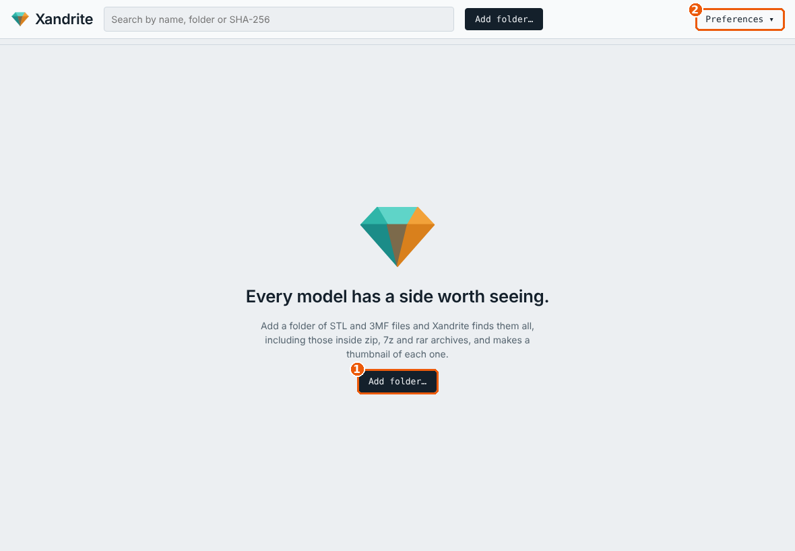

Preferences (2) holds the less common settings, covered in [section 8](#8-preferences-and-housekeeping).

## 2. Wait for the scan

Xandrite now does two things, and you can start browsing straight away:

1. **Scan.** It finds every model, reads it and records its SHA-256 hash (a fingerprint of the file's contents).
   Two files with the same hash are the same model, even if they have different names or live in different folders.
2. **Thumbnails.** It draws a picture of each model in the background. The **Thumbnails** panel shows progress, and has
   **Pause** / **Resume** and **Retry failed** buttons if you need them.

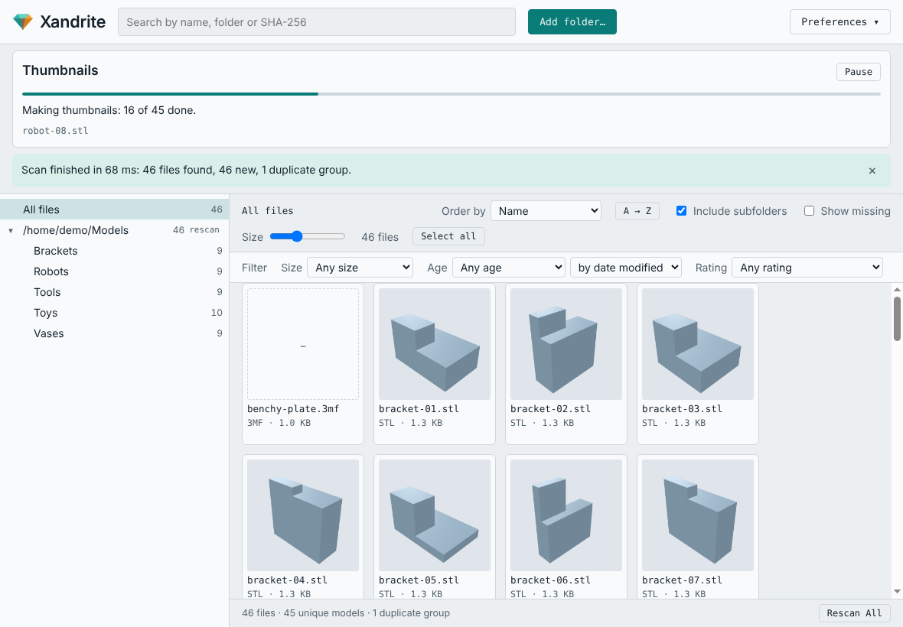

A big library takes a while the first time (thousands of files can take minutes). Later rescans only look at files
that are new or changed, so they are much quicker.

A yellow message bar appears when a scan finishes, summing up what was found. Click the **×** at its right to dismiss it.

## 3. Find your way around

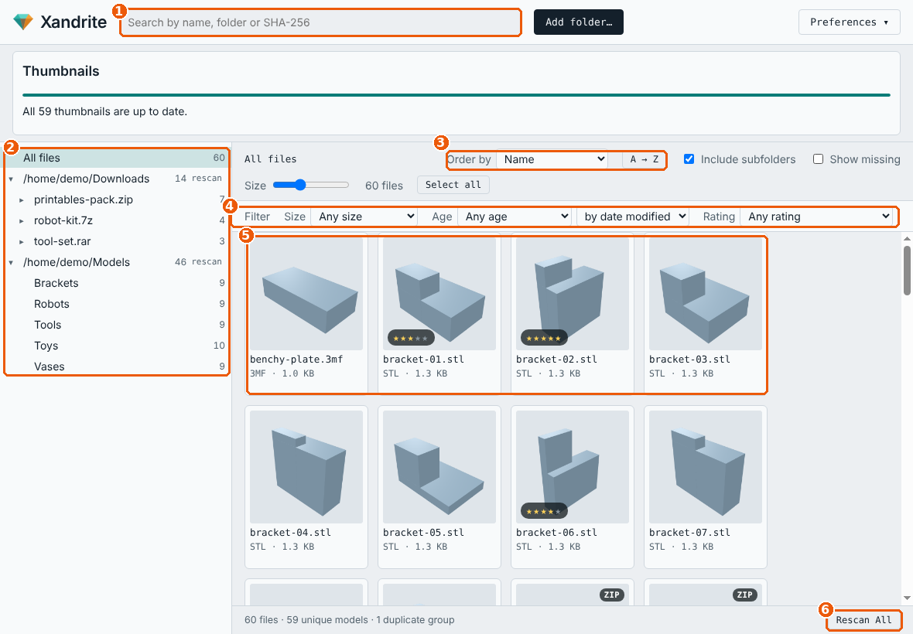

1. **Search.** Type part of a file name, a folder name, or a SHA-256 hash. The grid narrows as you type.
2. **Folder tree.** Click a folder to see only its models. **All files** shows everything. Archives (`.zip`, `.7z`,
   `.rar`) appear as folders too.
3. **Order by.** Sort by name, size, date, rating and so on. The **A → Z** button flips the direction.
4. **Filters.** Narrow by size, age or rating.
5. **The grid.** Each card shows the thumbnail, file name, type and size. The **Size** slider above the grid makes the
   thumbnails bigger or smaller.
6. **Rescan All.** Looks again in every folder for new, changed and removed files. Do this after you add models to a folder you already have.

Also on that toolbar:

- **Include subfolders** — untick to see only the models directly in the chosen folder.
- **Show missing** — tick to also list models whose original file has gone (a disconnected drive, say).

## 4. Look at a model

The viewer is there to **re-orient a model so its thumbnail shows it clearly**. Automatic thumbnails often get the angle
wrong, so you open the model, turn it to the view that shows it best, and save that view as its thumbnail. It is not
a modelling or editing tool, and it never changes the model file.

**Double-click** a thumbnail to open the viewer. It opens in its own window, the **Xandrite Thumbnailer**.

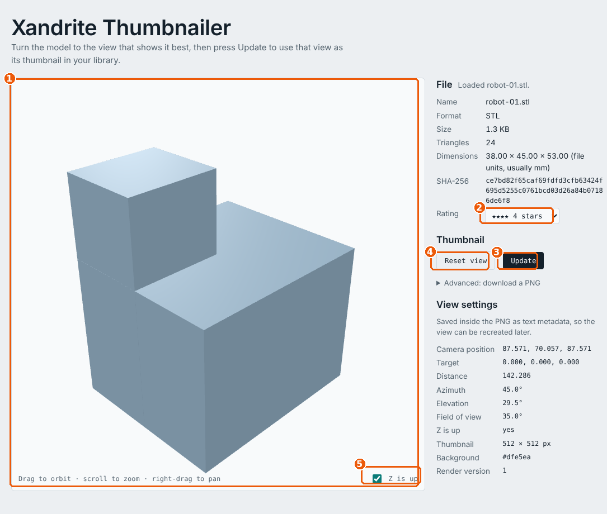

1. **3D view.** Drag with the left button to rotate, scroll to zoom, drag with the right button to move sideways.
2. **Rating.** Click the stars to give the model 1–5 stars.
3. **Update.** Saves the angle you are looking from as the model's thumbnail. This is the button the viewer exists
   for: use it once the model is turned the way you want it to be seen.
4. **Reset view.** Sits to the left of Update and goes back to the default angle.
5. **Z is up.** At the bottom right of the 3D view. Leave it ticked for most models; untick it if a model was made
   with Y pointing up and appears to lie on its side.

Automatic thumbnails rarely show a model at its best. The model may be upside down, lying on its side, or showing
you the back of its head. Rotate it until it looks right and press **Update**: from then on, that view is the
thumbnail. Select several models and right-click → **Regenerate thumbnails** to redraw them, or
**Revert to automatic view** to undo a hand-made view.

## 5. Rate, order and filter

Ratings are the quickest way to build a short list of favourites.

You can rate from the keyboard too: the **left** and **right arrow** keys move the selection one model at a time, and the keys **1** to **5** give the selected models that many stars. Press **0** to clear a rating.

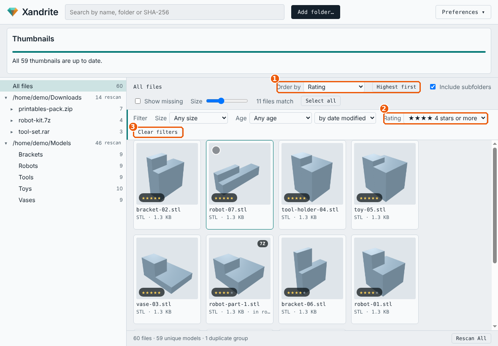

1. Set **Order by** to *Rating* to bring your best models to the top.
2. Use the **Rating** filter (for example "4 stars and above") to show only those.
3. **Clear filters** puts everything back.

## 6. Select several models and right-click

Selecting works the way it does in a file manager:

| Do this | To get this |
|---|---|
| Click | Select one model (click it again to deselect) |
| Ctrl-click | Add or remove one model |
| Shift-click | Select a whole range from the last click |
| **Select all** button or Ctrl+A | Select every model that matches the current search and filters |
| Esc | Clear the selection |
| Double-click | Open in the viewer |

A teal outline and a tick mark the selected models, and a bar shows how many are selected.

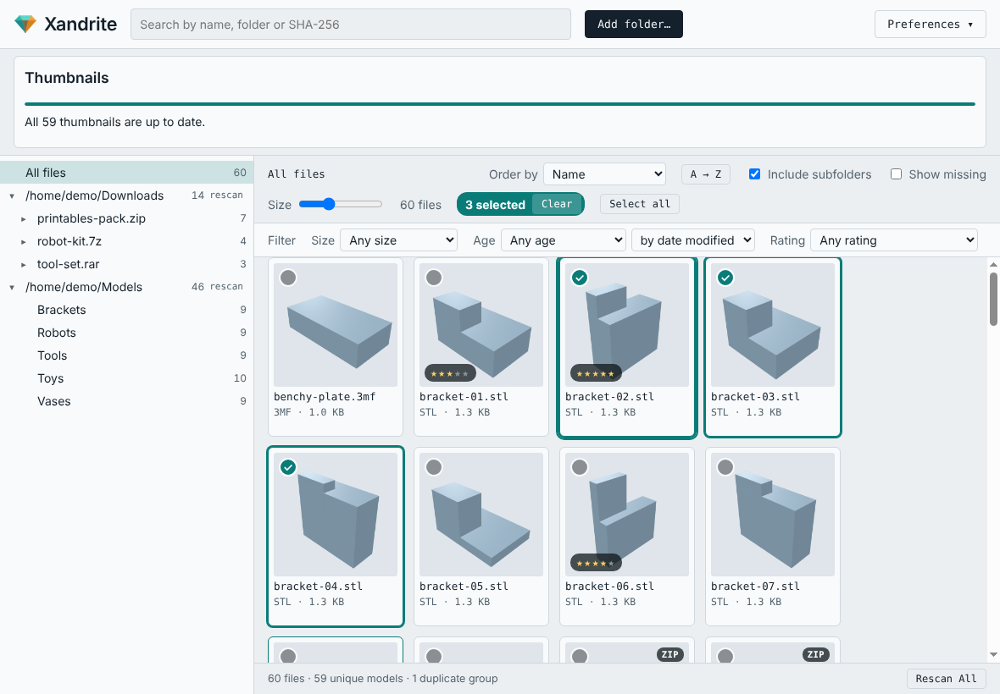

**Right-click** a selection for the actions menu:

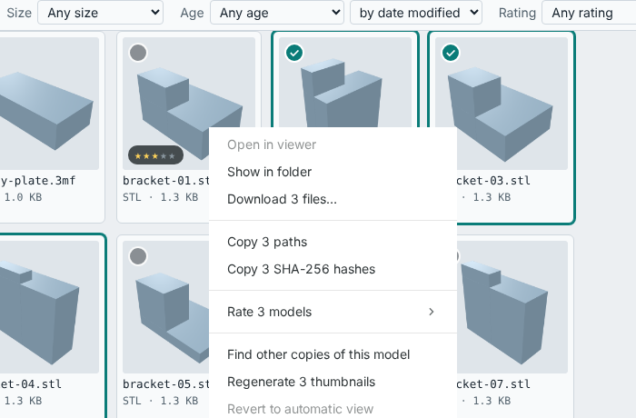

- **Open in viewer** — only when exactly one model is selected.
- **Show in folder** — opens the folder in your file manager. Only available when everything selected is in the same
  folder. For a model inside an archive it opens the folder that holds the archive.
- **Download…** — copies the selected models to a folder you choose (see below).
- **Copy paths** / **Copy SHA-256 hashes** — puts them on the clipboard, one per line.
- **Rate** — rates all the selected models at once.
- **Find other copies of this model** — shows every file with the same contents.
- **Regenerate thumbnails** — redraws them.
- **Revert to automatic view** — removes a hand-made thumbnail view.

Right-clicking a folder in the tree offers **Rescan this folder**, **Show in folder**, **Copy path** and
**Remove from library…** (which only forgets the folder; your files are not touched).

### Download

Download is especially useful for a model that is archived inside a compressed file. It takes one model or many, from
one archive or from several, and puts them in a folder you choose, without unpacking anything else.

**How to pull models out of an archive**

1. Find the models. Search, or click the archive in the folder tree to see only what is inside it.
2. Select them: click one, Ctrl-click to add more, Shift-click for a range, or **Select all**. You can mix models from
   different archives and loose files in the same selection.
3. Right-click and choose **Download…** (it reads **Download 3 files…** when three are selected).
4. Pick the destination folder. A new folder is a good idea if you are collecting a set of models for a job.
5. Watch the progress box. **Cancel** stops cleanly and leaves no half-written files behind.

**What happens behind the scenes**

- Each archive is opened once, and only the selected models are extracted from it, straight into your folder. The rest
  of the archive is not unpacked, and nothing is written anywhere else first. It works the same for `.zip`, `.7z`
  and `.rar`, including split archives.
- Models selected from the same archive are taken in one pass, so choosing 50 models from one big archive is not 50
  times slower than choosing one.
- The models arrive as plain files named after the model, not inside the archive's internal folders.
- Nothing is ever overwritten. If `bracket-01.stl` is already in the folder, the new copy is called
  `bracket-01 (2).stl`.
- Each copy is checked against the SHA-256 the library recorded, and keeps the model's original modified date. If a
  file has changed since the last scan, you are told.
- If something cannot be extracted (a damaged archive, or a model that is no longer inside it), the other models are
  still downloaded and the problem is reported at the end.

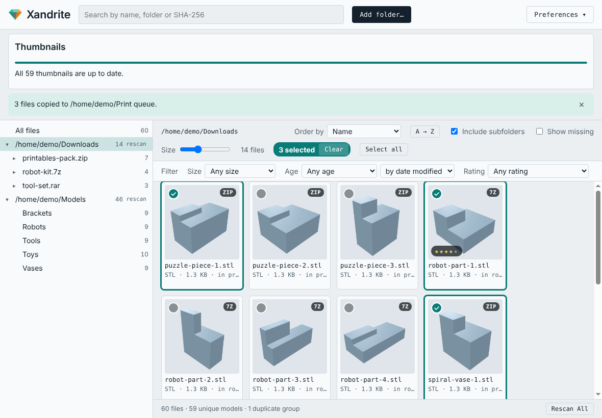

## 7. Models inside archives

This is the feature that saves the most time. Xandrite looks inside `.zip`, `.7z` and `.rar` files, including
split archives (`.7z.001`, `.part1.rar`, `.rar` + `.r00`), without unpacking them onto your disk. A small badge on
the thumbnail (ZIP, 7Z, RAR) tells you the model lives in an archive, and the folder tree lists each archive like a
folder, so you can also browse one archive at a time.

Because archived models are in the same index as everything else, searching, sorting, rating and finding duplicate
copies work across your whole collection, packed or not.

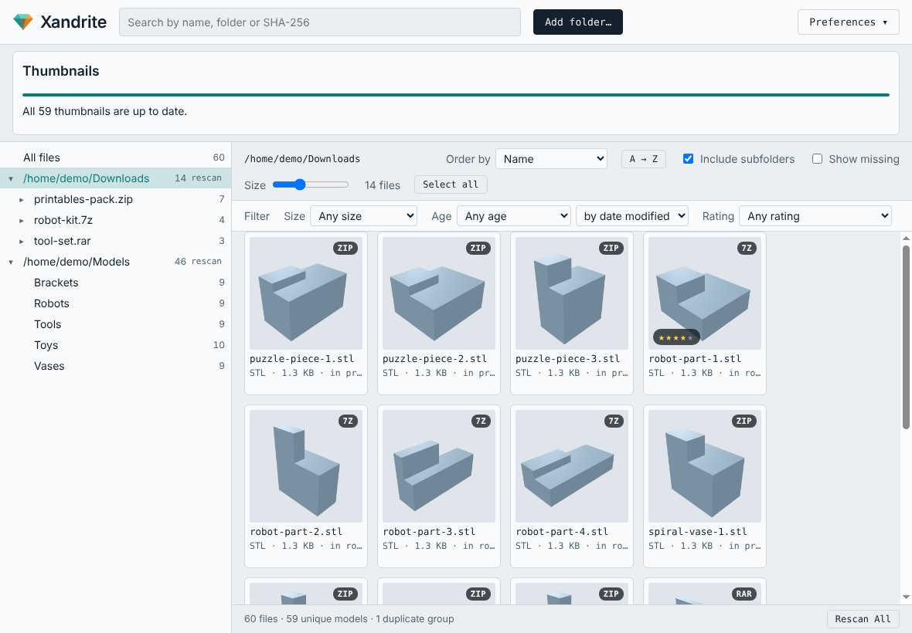

Everything works the same as for loose files, including the viewer, ratings and Download (see section 6). When you
find a model you want, **Download…** extracts just that model, however deep in the archive it is. If a split archive is missing
a part, the scan reports it and keeps what it knew before. Archives that need a password cannot be read; they are
listed as problems.

To switch archive searching off, untick it in Preferences.

## 8. Preferences and housekeeping

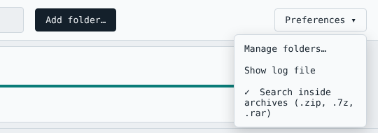

- **Manage folders…** lists the folders in your library, with the number of files and when each was last scanned. Use
  **Add folder…** to add several folders in a row: the scan starts when you close the dialog, and only if you added
  a new folder. Use **Remove…** to take a folder out of the library. To pick up changes in folders you already have,
  press **Rescan All** on the main window.
- **Show log file** opens the log, a plain-text record of each scan, hash, thumbnail and any error, with timestamps.
  Send it along when asking for help.
- **Search inside archives** turns archive scanning on or off.

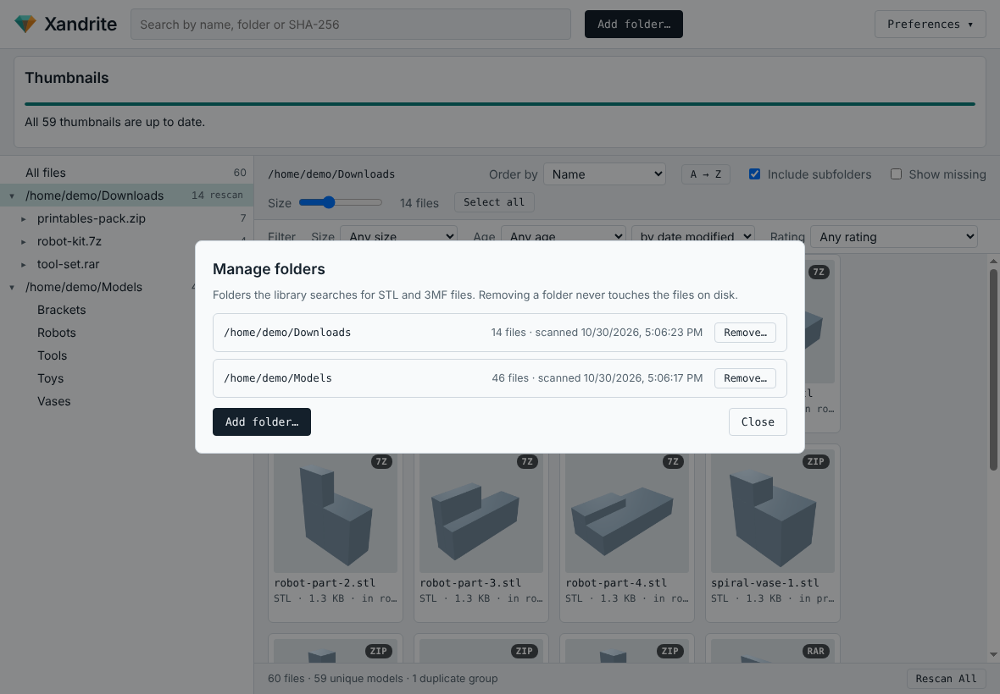

## Tips and troubleshooting

- **Added models are not showing.** Press **Rescan All**.
- **Some thumbnails failed.** Press **Retry failed** in the Thumbnails panel, or look in the log for the reason.
- **A model is missing after unplugging a drive.** It is kept in the library and shown under **Show missing** until
  the drive comes back and you rescan.
- **Two files look identical.** Right-click → **Find other copies of this model**. Same hash means the same contents.
- **Where is my data?** The library database and log live in `%APPDATA%\xandrite` on Windows (paste that into
  the File Explorer address bar) and in `~/.config/xandrite` on Linux. Deleting that folder resets the library;
  your models are untouched.
- **Upgrading from Model Library?** Xandrite is the new name of the same app. The first time it starts, it copies your
  library, thumbnails and ratings from the old `model-library` data folder. The old folder is left in place, so you can
  delete it once you are happy.
